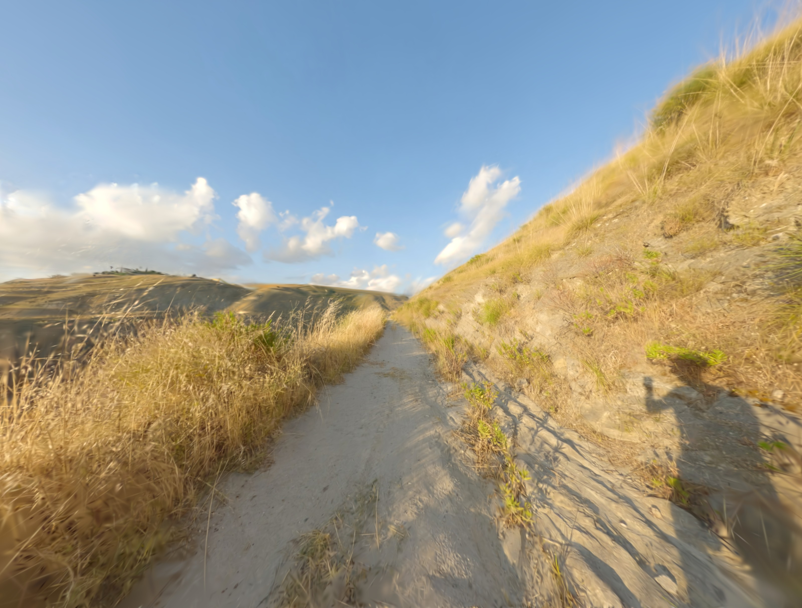
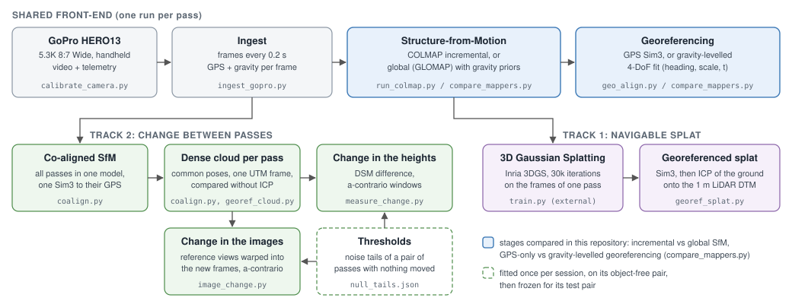
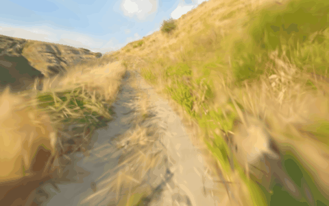

# Aspromonte: georeferenced trail reconstruction and change detection from a walking GoPro

[](https://github.com/diego-barreca-2004/Project_Aspromonte/actions/workflows/ci.yml)
[](LICENSE)


Action-camera video of a mountain trail, turned into a georeferenced 3D Gaussian Splatting
model and into change maps between repeated passes, in UTM coordinates.

<p align="center">
  
  <br><em>Rendered from the 3DGS model at one of its training camera poses
  (30 m stretch of the second pass, 121 frames at 3200 px).</em>
</p>

A handheld GoPro HERO13 was walked along the same 152 m trail in the Aspromonte massif
(Calabria, Italy) three times on different days in June and July 2026, and three more times
in one session in November 2026. From the raw video and its telemetry (GPS and gravity) this
repository builds

- **Track 1:** a navigable 3D Gaussian Splatting (3DGS) model, georeferenced by GPS and
  refined by ICP onto an open 1 m LiDAR terrain model;
- **Track 2:** the passes reconstructed together in one co-aligned SfM model, and the change
  between them measured both in the heights and in the images, with thresholds taken from a
  pair of passes in which nothing moved.

It wraps [COLMAP](https://colmap.github.io) and the
[Inria 3DGS](https://github.com/graphdeco-inria/gaussian-splatting) code, and adds GoPro
fisheye calibration, telemetry ingestion, gravity priors, georeferencing on near-linear
tracks, co-alignment of repeated passes and a-contrario change detection.

<p align="center">
  
</p>

## Quick start

One pass, end to end (frames, SfM, georeferencing, dense cloud and, with `splat true`, the
3DGS model):

```bash
python3 run_pipeline.py --config pipeline.conf --video seg01.mp4 --workdir seg01
```

Stages resume from existing outputs; `--from`/`--to` restrict the range, `--dry-run` prints
the plan, and QC gates stop the run on otherwise silent failures.

Compare passes (Track 2): reconstruct them in one model, then measure change against an
object-free pair (here ep2 vs ep1), whose noise tails set the threshold:

```bash
python3 coalign.py --pass ep1=seg01_ep1 --pass ep2=seg01_ep2 --pass ep3=seg01_ep3 \
    --calibration calib_out/calibration_fisheye.json --out coalign/seg01
P=coalign/seg01/passes
# object-free pair: writes null_tails.json, the null of the other pairs
python3 image_change.py --ref-seg $P/ep1 --cmp-seg $P/ep2 --out img_ep2_vs_ep1
python3 image_change.py --ref-seg $P/ep2 --cmp-seg $P/ep3 \
    --null-tails img_ep2_vs_ep1/null_tails.json --out img_ep3_vs_ep2
# measure_change.py takes the same arguments and measures the change in the heights
```

All stages and options: [docs/PIPELINE.md](docs/PIPELINE.md).

## Setup

```bash
python3 -m venv venv && venv/bin/pip install -r requirements.txt
for t in tests/test_*.py; do python3 "$t" || break; done   # synthetic scenes, known ground truth
```

Also needed: [COLMAP](https://colmap.github.io) with CUDA
([build notes for Blackwell GPUs](docs/BUILD_COLMAP_CUDA.md)), ExifTool ≥ 13.0, and for
Track 1 the [Inria 3DGS](https://github.com/graphdeco-inria/gaussian-splatting) code in
`gaussian-splatting/`. Tested on WSL2 (Ubuntu), RTX 5070 Ti Laptop, CUDA 12.8, Python 3.12;
see [docs/ENVIRONMENT.md](docs/ENVIRONMENT.md).

## Results

### Structure-from-Motion and georeferencing

- All three mappers (COLMAP incremental, global GLOMAP, global with GoPro gravity priors)
  register every frame at 0.38–0.45 px. Without gravity, the global mapper bent ep1 by up
  to 14° with a normal reprojection error; only GPS and gravity reveal it.
- On a near-straight walk GPS does not constrain the roll about the direction of travel.
  Levelling with the GoPro gravity cuts the tilt between passes from 5.6° to 0.6° (ep2 → ep1)
  and from 5.1° to 1.4° (ep3 → ep2), at the cost of a larger GPS residual (about 1 m).

Tables and the bent-model analysis: [docs/SFM_COMPARISON.md](docs/SFM_COMPARISON.md).

### 3D Gaussian Splatting

<p align="center">
  
  <br><em>3DGS model of the whole second pass, rendered along the walked path.</em>
</p>

### Change detection

Reconstructed alone and aligned by ICP, the height difference ep3 − ep2 on bare ground
still bends by 10 cm along the track (NMAD 5.4 cm). Reconstructed in one co-aligned model, the difference
is flat within 0.5 cm (NMAD 0.95 cm), with no ICP.

Each method gives every candidate change a significance and **states** it, i.e. declares
it real, when the significance passes a threshold. The threshold is set so that a pair of
passes in which nothing moved would give about 1 false change per km of track. Every design
choice was made on the object-free pair ep2 vs ep1 and on synthetic cylinders drawn into it;
the method was then frozen and tested twice on objects placed on the trail.

The two methods read different evidence in each 5 cm ground cell, then run the same test on it.

- **Heights** (`measure_change.py`) compare shape. Each pass gives a dense cloud, each cell
  gets a height from it, and the cue is the height difference dz between the two passes:
  did the ground go up or down here?
- **Images** (`image_change.py`) compare appearance and never reconstruct the new object.
  For each frame of the new pass, the frames of the old pass are warped into that view
  through the old geometry. The result is what the frame should look like if nothing had
  moved. The cue is the per-pixel error between that prediction and the real frame, carried
  down to the ground cell and averaged over every frame that sees it: do the photos here
  differ from what the old pass predicts?
- The test is the same for both: the mean of a window against the ring around it, judged
  against the tails of the object-free pair.

The two cues complement each other. An object one or two cells wide stays below the height
noise of the dense reconstruction, but in the frames it covers about a hundred pixels in tens
of views. In the second session, on the other hand, the heights state the ball and the jacket
and the images do not; why the images miss them was not checked.

**Second session (November 2026): object-free pair in the same session.** Pass A, pass B
with nothing changed, four objects placed, pass C, within about 15 minutes. Thresholds from
A vs B, objects looked at once on C vs B:

| Object (size from a phone measuring app) | Heights (`measure_change.py`) | Images (`image_change.py`) |
|-------------------------|-------------------------------|----------------------------|
| Backpack, speaker on top (55 × 31 cm, lying flat) | stated, 1st of 6 | stated, 1st of 3 |
| Bucket (50 cm wide, 30 cm high) | stated, 2nd of 6 | stated, 2nd of 3 |
| Ball (32 cm) | stated, 3rd of 6 | not stated |
| Jacket (54 × 46 cm, on the ground) | stated, 4th of 6 | not stated |
| False changes stated | 2 of 6 (12.7 per km) | 1 of 3 (6.3 per km) |

- **Heights:** all four objects are stated, ahead of any false change. The height noise is
  half that of the first test pair (NMAD of dz in `measure_change.py`: 0.45 cm on A vs B,
  0.90 cm on ep3 vs ep2). Two false changes are still more than 1 per km allows; one is the
  canopy of a 3–4 m shrub at the start of the track.
- **Images:** the backpack and the bucket are stated; the ball and the jacket are not.
- These objects are larger than those of the first session, so the gain cannot be split
  between the same-session null pair and the object size.

**First session (June–July 2026).** Thresholds from ep2 vs ep1, objects looked at once on
ep3 vs ep2:

| Object (width × height) | Heights (`measure_change.py`) | Images (`image_change.py`) |
|-------------------------|-------------------------------|----------------------------|
| Bucket (31 × 27 cm) | stated, 1st of 8 | not stated, 1st candidate |
| Ball (22 cm) | stated, 5th of 8 | not stated, 3rd candidate |
| Black cylinder (7.4 × 17 cm) | missed | not stated, 2nd candidate |
| False changes stated | 6 of 8 (39.5 per km) | none |

- **Heights:** the bucket and the ball are stated, but so are 6 false changes, far more
  than 1 per km: the height noise of the test pair is larger than the object-free pair
  predicted. The cylinder is below that noise.
- **Images:** nothing is stated, because the object-free pair is noisier than the test pair
  and its threshold is too strict here. Sorted by significance, though, the three objects
  are the first three candidates of the whole track: a looser threshold would state all
  three before any false change.

Details: [docs/CHANGE_DETECTION.md](docs/CHANGE_DETECTION.md).

## Limitations

- **One segment, two sessions:** a single 152 m trail on an open slope, six passes in all;
  forest canopy, longer sequences and other cameras are untested.
- **Small objects:** a 7.4 cm dark cylinder stays below the height noise of MVS at
  `max_image_size` 1000, and in the images it is ranked but not stated. The second
  session has no object that small.
- **Two tests, few objects:** seven placed objects over two test pairs; the false-change
  rate is measured on 0.15 km per pair.
- **Vegetation:** tall shrubs are sampled differently from pass to pass, and one gives a
  false change in the heights of the second session.
- **Georeferencing:** consumer GPS gives metre-level accuracy; ICP onto the DTM brings the
  ground to 0.3–0.4 m RMS but leaves a tilt of 1.6–3.2° per model.
- **Splat views off the walked path** show floaters and a smeared background.

## License

MIT ([LICENSE](LICENSE)). COLMAP and GLOMAP are BSD; the Inria 3DGS code is
non-commercial and applies to Track 1 only. Track 2 also uses plyfile, which is
GPL-3.0-or-later; its other dependencies are permissive.

## Acknowledgements

Built on [COLMAP](https://colmap.github.io), [GLOMAP](https://github.com/colmap/glomap),
[3D Gaussian Splatting](https://github.com/graphdeco-inria/gaussian-splatting),
[py4dgeo](https://github.com/3dgeo-heidelberg/py4dgeo) and OpenCV. Elevation data: PST
LiDAR DTM (MASE, CC BY 4.0), Regione Calabria and TINITALY (INGV).
