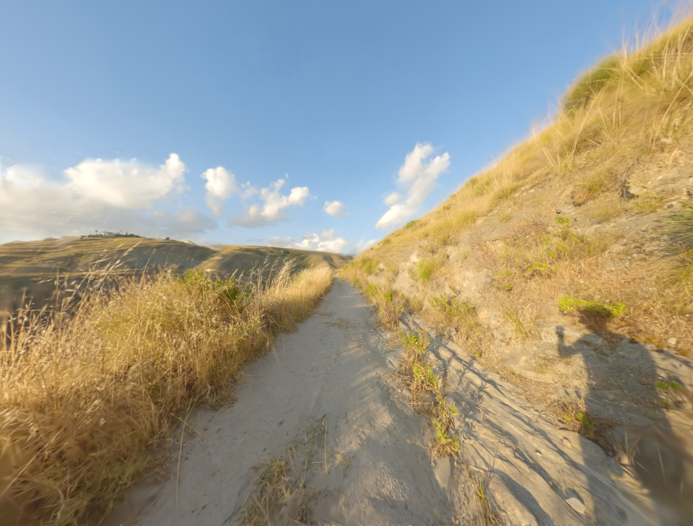
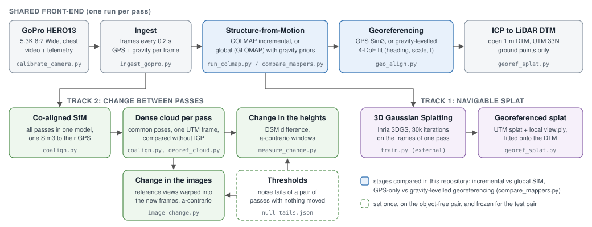
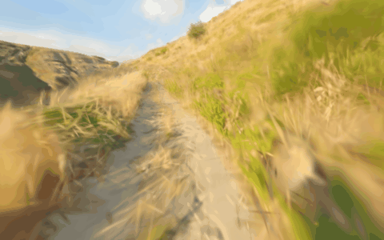

# Aspromonte: georeferenced trail reconstruction and change detection from a walking GoPro

[](https://github.com/diego-barreca-2004/Project_Aspromonte/actions/workflows/ci.yml)
[](LICENSE)


Action-camera video of a mountain trail, turned into a georeferenced 3D Gaussian Splatting
model and into change maps between repeated passes, in UTM coordinates.

<p align="center">
  
  <br><em>Rendered from the 3DGS model at one of its training camera poses
  (30 m stretch of the second pass, 121 frames at 3200 px).</em>
</p>

A GoPro HERO13 was walked three times along the same 152 m trail in the Aspromonte massif
(Calabria, Italy). From the raw video and its telemetry (GPS and gravity) this repository
builds

- **Track 1:** a navigable 3D Gaussian Splatting (3DGS) model, georeferenced by GPS and
  refined by ICP onto an open 1 m LiDAR terrain model;
- **Track 2:** the passes reconstructed together in one co-aligned SfM model, and the change
  between them measured both in the heights and in the images, with thresholds taken from a
  pair of passes in which nothing moved.

## Features

- **GoPro calibration:** a ChArUco board filmed once gives the fisheye (Kannala-Brandt)
  intrinsics, with per-view reprojection errors and an undistortion preview.
- **Telemetry ingestion:** frames every 0.2 s, each with its GPS position and gravity
  vector read from the GoPro metadata.
- **Structure-from-Motion with gravity priors:** COLMAP incremental, or the global mapper
  (GLOMAP) with the GoPro gravity as a prior on every pose.
- **Georeferencing on near-straight walks:** GPS fit, or a gravity-levelled fit that also
  fixes the roll about the direction of travel, which GPS alone cannot see; then ICP onto an
  open 1 m LiDAR terrain model.
- **Co-aligned passes:** all passes in one SfM model, so their dense clouds share one frame
  and are compared without ICP.
- **Change measured with a false-alarm budget:** in the heights and in the images, a change
  is stated only if a pair of passes with nothing moved would produce fewer than a set number
  of such changes per km of track (a-contrario test).
- **One command per pass:** resumable stages, `--from`/`--to`, `--dry-run`, and QC gates that
  stop the run on failures that would otherwise be silent (wrong frame size, too few
  registered images, weak GPS fit, empty dense cloud, cloud in the wrong place).

## How it works

<p align="center">
  
</p>

1. **Shared front-end, one run per pass.** Frames and telemetry are extracted, SfM recovers
   the camera poses, and the model is scaled and placed in UTM coordinates by GPS and gravity.
2. **Track 1.** The frames of one pass train a 3DGS model, which is then fitted onto the
   LiDAR terrain model and saved both in UTM and in a local frame for viewers.
3. **Track 2.** All passes go into one SfM model, and each pass gets its own dense cloud in
   the common frame. `measure_change.py` compares the heights of two passes and
   `image_change.py` warps the reference views into the new frames and compares the images.
4. **Thresholds.** Both tools are first run on a pair of passes with no objects placed; the
   noise tails of that pair are saved in `null_tails.json` and set the threshold for every
   other pair.

## Installation

You need **Python 3.11 or newer**, [COLMAP](https://colmap.github.io) with CUDA
([build notes for Blackwell GPUs](docs/BUILD_COLMAP_CUDA.md)) and ExifTool 13.0 or newer.
Track 1 also needs the [Inria 3DGS](https://github.com/graphdeco-inria/gaussian-splatting)
code in `gaussian-splatting/`.

```bash
git clone https://github.com/diego-barreca-2004/Project_Aspromonte.git
cd Project_Aspromonte
python3 -m venv venv && venv/bin/pip install -r requirements.txt
venv/bin/pip install "pycolmap>=4.2"   # only for compare_mappers.py and the gravity priors
```

Tested on WSL2 (Ubuntu), RTX 5070 Ti Laptop, CUDA 12.8, Python 3.12; see
[docs/ENVIRONMENT.md](docs/ENVIRONMENT.md).

## Usage

### One pass: `run_pipeline.py`

Frames, SfM, georeferencing, dense cloud and, with `splat true`, the 3DGS model:

```bash
python3 run_pipeline.py --config pipeline.conf --video seg01.mp4 --workdir seg01
```

Stages resume from existing outputs; `--from`/`--to` restrict the range and `--dry-run`
prints the plan.

### Change between passes: `coalign.py`, `image_change.py`, `measure_change.py`

Reconstruct the passes in one model, then measure the change against an object-free pair
(here ep2 vs ep1), whose noise tails set the threshold:

```bash
python3 coalign.py --pass ep1=seg01_ep1 --pass ep2=seg01_ep2 --pass ep3=seg01_ep3 \
    --calibration calib_out/calibration_fisheye.json --out coalign/seg01
P=coalign/seg01/passes
# object-free pair: writes null_tails.json, the null of the other pairs
python3 image_change.py --ref-seg $P/ep1 --cmp-seg $P/ep2 --out img_ep2_vs_ep1
python3 image_change.py --ref-seg $P/ep2 --cmp-seg $P/ep3 \
    --null-tails img_ep2_vs_ep1/null_tails.json --out img_ep3_vs_ep2
# measure_change.py takes the same arguments and measures the change in the heights
```

All stages and options: [docs/PIPELINE.md](docs/PIPELINE.md).

## Results

### Structure-from-Motion and georeferencing

- All three mappers (COLMAP incremental, global GLOMAP, global with GoPro gravity priors)
  register every frame at 0.38–0.45 px. Without gravity, the global mapper bent ep1 by up
  to 14° with a normal reprojection error; only GPS and gravity reveal it.
- On a near-straight walk GPS does not constrain the roll about the direction of travel.
  Levelling with the GoPro gravity cuts the tilt between passes from 5.6° to 0.6° (ep2 → ep1)
  and from 5.1° to 1.4° (ep3 → ep2), at the cost of a larger GPS residual (about 1 m).

Tables and the bent-model analysis: [docs/SFM_COMPARISON.md](docs/SFM_COMPARISON.md).

### 3D Gaussian Splatting

<p align="center">
  
  <br><em>3DGS model of the whole second pass, rendered along the walked path.</em>
</p>

### Change detection

Reconstructed alone and aligned by ICP, the height difference ep3 − ep2 on bare ground
still bends by 10 cm along the track (NMAD 5.4 cm). Reconstructed in one co-aligned model, the difference
is flat within 0.5 cm (NMAD 0.95 cm), with no ICP.

Each method gives every candidate change a significance and **states** it, i.e. declares
it real, when the significance passes a threshold. The threshold is set so that a pair of
passes in which nothing moved would give about 1 false change per km of track. It was set,
like every other design choice, on the object-free pair ep2 vs ep1 and on synthetic
cylinders drawn into it. The placed objects were looked at once, on the test pair ep3 vs
ep2, with everything frozen:

| Object (width × height) | Heights (`measure_change.py`) | Images (`image_change.py`) |
|-------------------------|-------------------------------|----------------------------|
| Bucket (31 × 27 cm) | stated, 1st of 8 | not stated, 1st candidate |
| Ball (22 cm) | stated, 5th of 8 | not stated, 3rd candidate |
| Black cylinder (7.4 × 17 cm) | missed | not stated, 2nd candidate |
| False changes stated | 6 of 8 (39.5 per km) | none |

- **Heights:** the bucket and the ball are stated, but so are 6 false changes, far more
  than 1 per km: the height noise of the test pair is larger than the object-free pair
  predicted. The cylinder is below that noise.
- **Images:** nothing is stated, because the object-free pair is noisier than the test pair
  and its threshold is too strict here. Sorted by significance, though, the three objects
  are the first three candidates of the whole track: a looser threshold would state all
  three before any false change.

Details: [docs/CHANGE_DETECTION.md](docs/CHANGE_DETECTION.md).

## Limitations

- **One segment, three passes:** a single 152 m trail on an open slope; forest canopy,
  longer sequences and other cameras are untested.
- **Small objects:** a 7.4 cm dark cylinder stays below the height noise of MVS at
  `max_image_size` 1000, and in the images it is ranked but not stated.
- **One object-free pair:** all thresholds come from ep2 vs ep1, noisier than the test pair.
  A null pair recorded in the same session as the test pair would match its noise; a new
  session is planned.
- **Georeferencing:** consumer GPS gives metre-level accuracy; ICP onto the DTM brings the
  ground to 0.3–0.4 m RMS but leaves a tilt of 1.6–3.2° per model.
- **Splat views off the walked path** show floaters and a smeared background.

## Development

```bash
for t in tests/test_*.py; do venv/bin/python "$t" || break; done
```

Each test builds a synthetic scene with known ground truth and checks the result against
it. The suite runs offline in about 20 s with only `requirements.txt`: no COLMAP, no GPU and
no field data. CI runs it on every push, on Python 3.11 to 3.14.

## License

[MIT](LICENSE) © 2026 Diego Barreca.

The repository does not bundle third-party code. Its dependencies are installed separately
and keep their own licenses: NumPy, SciPy and rasterio (BSD-3-Clause), pyproj and py4dgeo
(MIT), OpenCV (Apache-2.0), Matplotlib (PSF-based), plyfile (GPL-3.0-or-later), COLMAP,
GLOMAP and pycolmap (BSD-3-Clause) and ExifTool (Perl license). The Inria 3DGS code is
licensed for non-commercial research only and is needed for Track 1 only.

## Acknowledgements

Built on [COLMAP](https://colmap.github.io), [GLOMAP](https://github.com/colmap/glomap),
[3D Gaussian Splatting](https://github.com/graphdeco-inria/gaussian-splatting),
[py4dgeo](https://github.com/3dgeo-heidelberg/py4dgeo) and OpenCV. Elevation data: PST
LiDAR DTM (MASE, CC BY 4.0), Regione Calabria and TINITALY (INGV).
