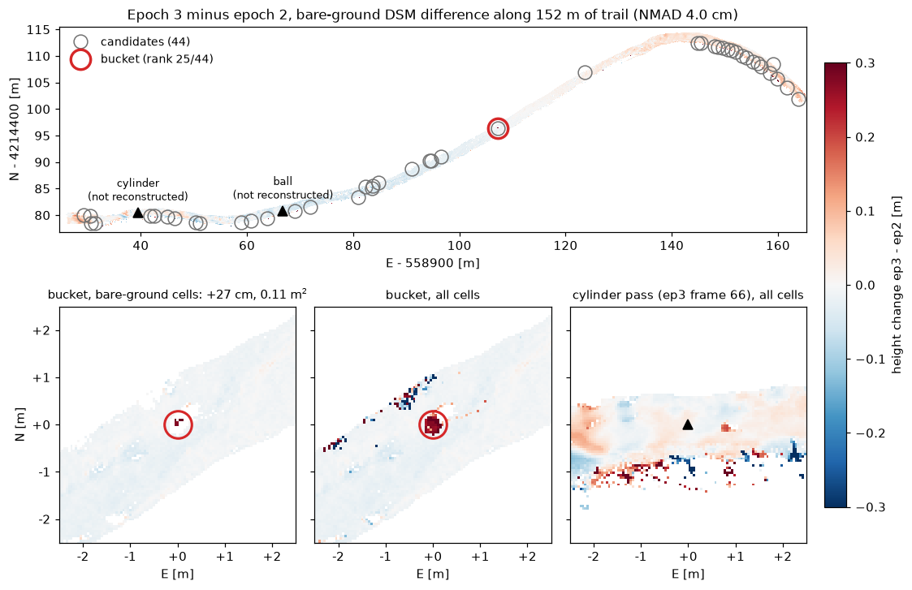

# Track 2: georeferenced change detection

Track 2 reuses the front-end of [PIPELINE.md](PIPELINE.md) (capture, calibration, SfM, DTM
and the Sim3 in `geo_transform.txt`), replaces 3DGS with dense MVS, and compares epochs.
The Sim3 applies unchanged to the dense cloud, because `image_undistorter` does not move
the 3D frame.

There are two generations. v1 reconstructs each pass alone and aligns the clouds by ICP;
its residual drift between passes shows up as false changes. v2 reconstructs the passes
together and tests each change against the noise of an object-free pair of passes.

## Dense reconstruction

`patch_match_stereo` is CUDA-only. On Blackwell GPUs COLMAP must be built with
`-DCMAKE_CUDA_ARCHITECTURES=89`, not 120: arch 120 miscompiles the PatchMatch kernels and
silently yields empty depth maps. Build and commands: [BUILD_COLMAP_CUDA.md](BUILD_COLMAP_CUDA.md).

All epochs are reconstructed with the same parameters, so that differences reflect the
terrain and not the pipeline:

| Stage | Parameter | Value |
|-------|-----------|-------|
| `patch_match_stereo` | `max_image_size` | `1000` |
| `patch_match_stereo` | `geom_consistency` | `true` |
| `patch_match_stereo` | `filter` | `true` |
| `stereo_fusion` | `input_type` | `geometric` (default thresholds) |
| `georef_cloud.py` (SOR) | `iters / k / std` | `2 / 20 / 2.0` |

## Georeferencing the dense cloud

`georef_cloud.py` removes MVS floaters (iterative statistical outlier removal), applies the
Sim3 and writes float64 absolute UTM; float32 would quantise the ~4.2 × 10⁶ m northings to
~0.25 m.

```bash
python3 georef_cloud.py ./seg01/colmap/dense/fused.ply \
        ./seg01/colmap/geo_transform.txt ./seg01/colmap/dense/fused_utm.ply
```

Reference run on `seg01`: 4,533,733 points, 4,460,797 after SOR (the removed 1.6 % held
~98 % of the bounding box).

## v1: per-pass clouds, M3C2 and DSM differencing

**M3C2** (`run_m3c2.py`, py4dgeo) measures distributed surface change along local
normals. It crops both clouds to the mutual footprint, registers them (a CloudCompare ICP
matrix via `--icp`, or the built-in `--auto-icp`), picks core points, runs M3C2 and writes
the distance and significance map with stable-patch statistics:

```bash
python3 run_m3c2.py --ref seg01/colmap/dense/fused_utm.ply \
                    --cmp seg01_ep2/colmap/dense/fused_utm.ply \
                    --icp icp_ep2_to_ep1.txt --cc-shift -559000 -4214000 0 \
                    --patch 559010,4214480,3 --out m3c2_out
```

Run once with `--reg-error 0`, then again with the value suggested by the stable-patch
statistics, so that significance accounts for the residual registration error.

**DSM differencing** (`dsm_change.py`) targets compact objects on a near-horizontal
trail. Inside a corridor around the GPS track it grids both epochs (90th height percentile
per 5 cm cell), keeps cells that are bare ground in the epoch the change is measured
against, removes the median offset, and reports connected blobs above
max(10 cm, 4 × NMAD):

```bash
python3 dsm_change.py --ref seg01_ep2/colmap/dense/fused_utm.ply \
    --cmp seg01_ep3/colmap/dense/fused_utm.ply \
    --icp m3c2_ep3_vs_ep2_v2/icp_auto.txt --cc-shift -558997 -4214492 -123 \
    --track seg01_ep2/gps.csv --out dsm_ep3_vs_ep2
```

## v1 results on seg01

Three epochs of the same 152 m dirt road on an open dry-grass slope, walked with a
handheld GoPro. Objects placed on the trail: a flat plasterboard sheet in epoch 2; a
black cylinder, a ball and a white bucket in epoch 3. Epoch 3 was filmed in low light,
epoch 2 in sun.

Noise on bare ground (NMAD):

| Pair | M3C2 | DSM difference |
|------|------|----------------|
| ep2 vs ep1 | 3.9 cm | 1.3 cm |
| ep3 vs ep2 | 6.3 cm | 4.0 cm |

Per object:

| Object | Outcome |
|--------|---------|
| Bucket | Reconstructed; found 8 cm from its expected position, 0.11 m², +27 cm. |
| Cylinder, ball | Not reconstructed by MVS at `max_image_size` 1000. |
| Plasterboard (~1.3 cm thick) | Below the detection floor. |

Automatic detection with default parameters is **not yet discriminative**: ep3 vs ep2
gives 44 candidates with the bucket ranked 25th; the object-free control (ep2 vs ep1)
gives 48. False positives come from the sequence ends, an eastern stretch with non-rigid
drift, and grassy edges. v2 below removes the drift at its source, in the SfM.



The figure is drawn by `scripts/change_map_figure.py` (command in its docstring).

## v2: co-aligned passes, thresholds from an object-free pair

### Co-alignment (`coalign.py`)

All passes of a segment go into one SfM model (Time-SIFT: Feurer and Vinatier 2018; Cook
and Dietze 2019): consecutive frames are matched inside each pass, and frames of different
passes within `--radius` of each other along the GPS track are matched across passes. One
GPS Sim3 georeferences all passes; each pass is then split into `<out>/passes/<label>/`
with the common poses, densified with the parameters above and georeferenced with
`georef_cloud.py`. Another `--max-image-size` goes with another `--passes-dir`: the joint
model is shared, the dense clouds of each size are kept apart.

```bash
python3 coalign.py --pass ep1=seg01_ep1 --pass ep2=seg01_ep2 --pass ep3=seg01_ep3 \
    --calibration calib_out/calibration_fisheye.json --out coalign/seg01
```

On ep3 vs ep2 (bare-ground cells, height difference):

| | Per pass + ICP | Co-aligned |
|---|---|---|
| NMAD | 5.37 cm | 0.95 cm |
| Median per 10 m of track | −4.2 to +6.1 cm | flat within 0.5 cm |
| Appear/disappear pairs within 0.5 m | 183 | 10 |

### Change in the heights (`measure_change.py`)

The analysis area is the set of 5 cm cells seen by at least two cameras of each pass. Per
cell: DSM height in each pass, a noise model of the difference from point counts, height
spread, views and ray geometry (after Hugonnet et al. 2022), and a normal score. The test
is a-contrario: the contrast D between a window and its ring, for window sides from 10 cm to
2 m, against generalised Pareto tails of D fitted on the object-free pair (declustered
peaks, per window side, roughness class and sign). A change is stated where the number of
false alarms (NFA) is below `--epsilon` per km of track.

### Change in the images (`image_change.py`)

An object one or two cells wide stays below the height noise of MVS at 1000 px, while in
the frames it covers about a hundred pixels in tens of views. For each frame of the new
pass, the reference cloud is rendered into its depth, the three nearest reference frames
are warped into it, and the cue per pixel is 0.8 L1 + 0.2 (1 − SSIM), the minimum over the
three. Each pixel votes on the 5 cm UTM grid at the nearer surface of the two passes; the
score of a cell is the mean over the frames that see it. The a-contrario test is the one
above, with tails per class of views per cell. Related label-free methods: 3DGS-CD
(arXiv 2411.03706), MV3DCD (arXiv 2412.03911), SCaR-3D (arXiv 2512.22830).

```bash
P=coalign/seg01/passes
python3 image_change.py --ref-seg $P/ep1 --cmp-seg $P/ep2 --out img_ep2_vs_ep1
python3 image_change.py --ref-seg $P/ep2 --cmp-seg $P/ep3 \
    --null-tails img_ep2_vs_ep1/null_tails.json --out img_ep3_vs_ep2
```

### Evaluation protocol

- Object-free pair: ep2 vs ep1 (N1), with a 3 m zone around the plasterboard sheet of ep2
  excluded. Every run writes its own `null_tails.json`; other pairs are tested against the
  tails of N1.
- Design choices are made on N1 and on synthetic objects only (`scripts/synthetic_objects.py`
  in the clouds, cylinders drawn into the frames for `image_change.py`): tails fitted on one
  half of the track, objects placed on the other half, recall and false changes per km.
- The placed objects are measured in the frames (`scripts/object_ground_truth.py`) and are
  used once, on the frozen method. `cd_eval.py` reports false changes per km, object ranks
  and FROC; it prints the real objects only with `--reveal-objects`.

### v2 results on seg01

ep3 vs ep2, three-pass co-aligned model, tails of N1, ε = 1 false change per km:

| | Heights | Images |
|---|---|---|
| Statements | 8, of which 6 false (39.5 per km) | 0 |
| Bucket | 1st | ranked 1st (stated from 2.6 per km) |
| Ball | 5th | ranked 3rd (stated from 132 per km) |
| Cylinder | missed | ranked 2nd (stated from 10.5 per km) |

"Ranked" is the order of the blobs of the NFA map; "stated from" is the threshold at which
the object would be stated, sweeping it over the map. The first false change in the
images comes at 167 per km (6.6 per km observed).

On synthetic cylinders (5–30 cm wide, 5–30 cm high) on half of N1, with tails from the
other half, `image_change.py` at 1 per km finds 35 % of those 10 cm wide or larger, with no
false change; at 5 per km, 48 %, with 7 false changes per km.

### Calibration

N1 is noisier than ep3 vs ep2 (median image score 0.134 against 0.094), so its tails make
the test conservative on the test pair. Pairs of a pass with itself (ref = cmp, each frame
compared with its neighbours, never with itself) are quieter still (0.048 and 0.060): with
the N1 tails they state no false change up to 100 per km. Two corrections were rejected on
N1 and the synthetic objects:

- D divided by the robust scale (NMAD) of the pair: 21 false changes per km at 1 per km on
  ep1 vs ep1 with the N1 tails;
- tail classes by local background (ring mean or ring standard deviation of the score)
  instead of views: 7 and 14 false changes per km at 1 per km on N1, lower recall.

The remaining fix is in the data: an object-free pair with the noise of the test pair, i.e.
recorded in the same session (below).

## Designing a controlled change

Measure the noise floor first, on two captures of the unchanged scene. A test object should
sit 3–5 times above it: larger than the point spacing, taller than the noise. A rigid
object of known size gives quantified accuracy; moved soil or rock gives the paired
positive and negative signature closest to real erosion. Thin, dark or glossy objects
reconstruct poorly. Keep path, camera, time of day and weather the same across epochs.

Record the object-free pair in the same session as the test pair: pass A, pass B with
nothing changed, place the objects, pass C. The tails fitted on A vs B then match the noise
of B vs C. An object-free pair from other days can be noisier (N1 here, so the test is
conservative) or quieter (so the test states false changes).
